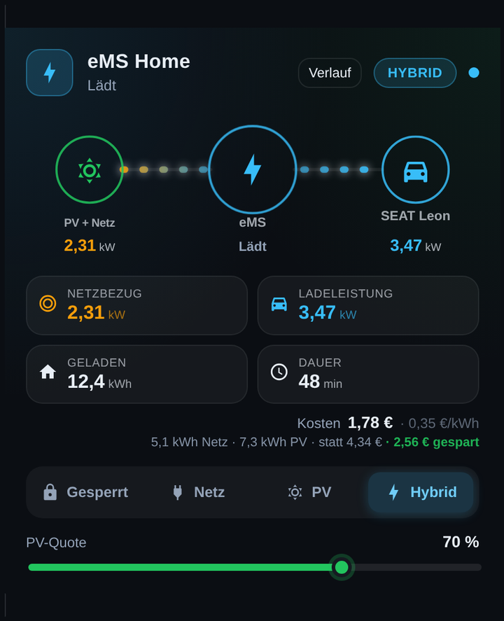
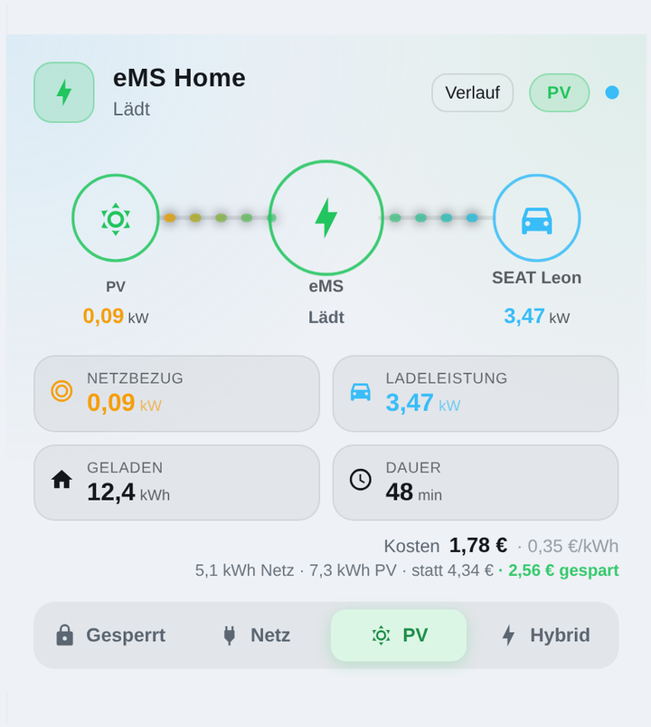
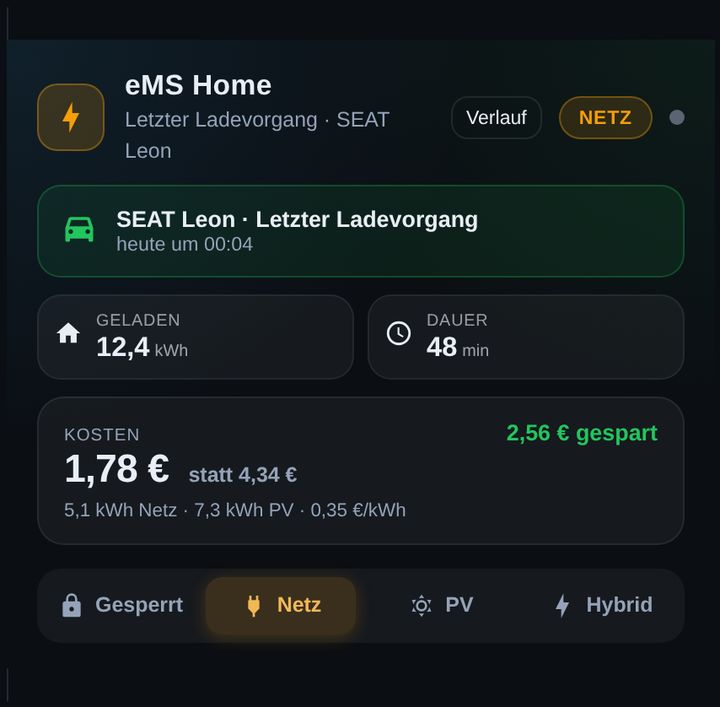
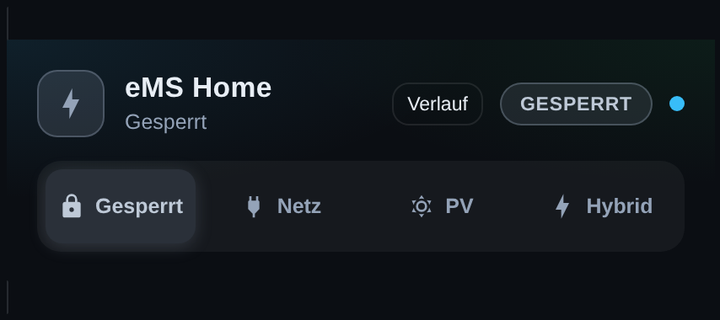
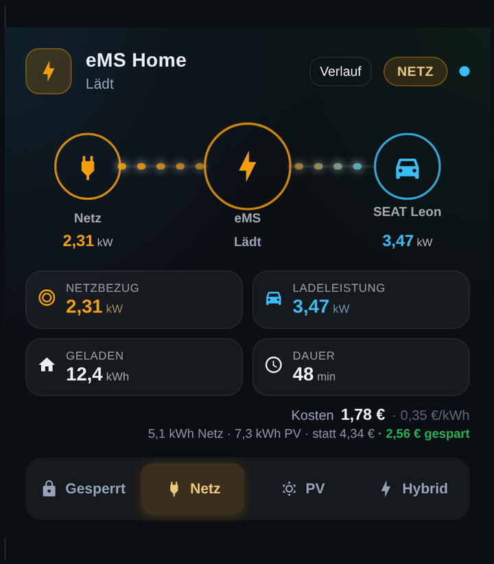

# ABL eMS Home for Home Assistant


[](https://hacs.xyz/)
[](https://github.com/TorbenStriegel/eMS-Home-HomeAssistant/releases)
[](LICENSE)
[![Add Integration][add-integration-badge]][add-integration]

Custom Home Assistant integration for the **ABL eMS Home** energy management system:
real-time smart meter data over WebSocket, EV charging monitoring and charge-mode
control for ABL eMH1 wallboxes — plus a bundled, animated Lovelace card.

## Features

- ⚡ **Live smart meter** – grid power (total + per phase), voltage, current, frequency, energy import/export, reactive power, power factor
- 🚗 **Wallbox live stream** – status, session duration, session energy, total energy, serial, hardware current limit, error code
- 🔌 **EV charging power** – total and per phase, plus a curtailment setpoint
- 🎛️ **Charge mode control** – Grid / PV / Hybrid / Lock as a select entity
- ☀️ **PV quota slider** – minimum PV surplus in 10 % steps (as in the original web UI), shown in hybrid mode where it applies
- 🖥️ **Device health** – CPU load/temperature, RAM and flash usage as diagnostic entities
- 🩺 **Self-diagnosing** – live-stream connectivity binary sensors, frame counters and a full diagnostics download
- 🚙 **Vehicle name** – optional sensor, shown on the card and in every message
- 🎨 **Bundled card** – `custom:ems-home-card` with an animated energy flow (no manual resource setup)
- 🔄 **Self-healing** – WebSocket reconnect with backoff, keep-alive pings, handshake and read timeouts
- 💸 **Costs per charge** – grid/PV split, cost and saving per cycle, with the counterfactual on the card
- 📊 **Charging history** – local session storage, four period sensors, an in-card history view, private CSV/JSON export and monthly archiving
- 🔔 **Notifications & events** – `ems_home_charging_started` / `_finished` for automations, or a built-in push; plus services to test both without a charge
- 🔐 **OAuth2** – automatic token management and renewal

## Installation via HACS (custom repository)

1. HACS → **Integrations** → ⋮ → **Custom repositories**
2. Repository: `https://github.com/TorbenStriegel/eMS-Home-HomeAssistant`, category **Integration**
3. Install **ABL eMS Home**, then **restart Home Assistant**

## Manual installation

Copy `custom_components/ems_home` into `config/custom_components/` and restart.

## Configuration

[![Add Integration][add-integration-badge]][add-integration] or **Settings → Devices & Services → Add Integration → ABL eMS Home**.

| Option | Description | Default |
|---|---|---|
| **Host** | IP address or hostname (e.g. `ems-home-12345678`) | – |
| **Password** | Password from the rating plate (user is always `admin`) | – |
| **Port** | HTTP port | `80` |
| **Poll interval** | Seconds between HTTP polls | `20` |
| **Request timeout** | Seconds per HTTP request | `10` |

Everything except the password can be changed later via **Configure**; the
password via the **re-authentication** flow (also triggered automatically when it
is rejected).

### Options

All of these live under **Configure**. The collapsed sections (*Charging
detection*, *Notifications*, *Charging history*) keep the dialog short.

**Connection**

| Option | Meaning | Default |
|---|---|---|
| Poll interval | Seconds between HTTP polls (the streams carry the live values), 3–600 | `20` |
| Request timeout | Seconds per HTTP request, 3–60 | `10` |
| Smart-meter stream | Live push from the meter – off leaves only the poll | on |
| Wallbox stream | Live push from the wallbox – off leaves only the poll | on |
| Verbose logging (debug) | DEBUG level plus a stream summary on every third poll that succeeds (about once a minute at the default 20 s interval) (up/down, frames, reconnects, age of the last frame). Costs CPU and fills the log. | off |

**Tariffs**

| Option | Meaning | Default |
|---|---|---|
| Grid price | €/kWh for grid energy. **Empty the field to switch the cost calculation off** | `0,35` |
| Value of own PV | €/kWh for your own solar energy (feed-in tariff or opportunity cost). `0` = free | `0` |

**Optional sensors** – all three are optional; without them the integration still works

| Option | What it is used for |
|---|---|
| PV production | `sensor.solar_power_total_w` – makes the grid/PV split of a charge more accurate |
| Battery discharge | `sensor.battery_discharge_power_w` (positive while discharging) – counts as own generation, like PV |
| Vehicle | `sensor.aktuelles_ladefahrzeug` – the car's name appears on the card (finished banner) and in notifications |

**Charging detection** (collapsed) – what counts as a charge and when it is over

| Option | Meaning | Default |
|---|---|---|
| Minimum power | The wallbox reports brief 0,1–0,3 kW samples while plugged; a new charge only starts above this | `1,0 kW` |
| Minimum duration | … and it must hold for this long, so a short impulse is not a charge | `60 s` |
| End of a charge | No flow for this long ends the session – also when the car stays plugged in (full battery) | `300 s` |
| Noise floor | Below this nothing is counted, neither energy nor cost | `0,35 kW` |

**Notifications** (collapsed, see [Notifications and automations](#notifications-and-automations))

| Option | Meaning | Default |
|---|---|---|
| Send a notification | Master switch – use either this or your own automation, not both | off |
| Notify service | **dropdown** of every notify service the instance offers (e.g. `notify.mobile_app_pixel`) | first one |
| Category / channel (Android) | `channel` – e.g. `Auto` or `Solar`. Afterwards that channel can be muted on the phone on its own | `eMS Home` |
| Importance (Android) | `importance` – `min`, `low`, `default`, `high`, `max` | `default` |
| Icon | `notification_icon`, e.g. `mdi:ev-station` | `mdi:ev-station` |
| Group (tag) | `tag` – messages with the same tag replace each other instead of stacking | `ems_home_charge` |
| **Send a test notification now** | tick it and save: a sample message with the last session's values goes to that service immediately. Nothing is written to the device. | off |
| … when a charge starts | short message with mode and price | off |
| … when a charge ends | cost, energy, duration, grid/PV share | on |

**Charging history** (collapsed, see [Charging history](#charging-history))

| Option | Meaning | Default |
|---|---|---|
| Enable charging history (`history_enabled`) | Record completed charges locally; disabled periods are not backfilled | on |
| Keep individual charging sessions (`history_retention_months`) | Integer months, 0–600; `0` = unlimited. Older details become monthly archive totals | `60` |

## The card

<p align="center">
  
  
</p>

<p align="center"><em>Charging in hybrid mode (dark) and in PV mode (light): the flow
shows where the energy comes from, the figures show what it is doing right now.</em></p>

The integration ships `custom:ems-home-card` and registers it automatically –
after installing or updating there is nothing to add to your dashboard resources.

- **The flow at a glance** – roof and grid on the left, wallbox in the middle, car on the right. The dots speed up with the power and reverse when you feed into the grid.
- **Live where it matters** – grid import refreshes every 5 s so the card stays calm, charging power is live.
- **Per cycle, not per day** – energy and duration belong to the current charging session and start over with the next one.
- **Control included** – Grid / PV / Hybrid / Lock plus the PV quota slider, which appears in hybrid mode where it applies.
- **Quiet when nothing happens** – locked and finished states show no animation and no meaningless zeros.

### The four states

<table>
  <tr>
    <td align="center" valign="top" width="33%">
      <br>
      <sub><b>Finished</b><br>The car is still plugged in but draws nothing: the
      animation gives way to the result – energy, duration, what the grid energy
      cost and what the roof saved.</sub>
    </td>
    <td align="center" valign="top" width="33%">
      <br>
      <sub><b>Locked</b><br>Nothing flows and nothing is worth showing, so only the
      header and the mode switch remain.</sub>
    </td>
    <td align="center" valign="top" width="33%">
      <br>
      <sub><b>Last charge</b><br>No car connected, but a session to report: the
      result of the last charge, kept until the next one starts.</sub>
    </td>
  </tr>
</table>

### Configuration

```yaml
type: custom:ems-home-card
title: eMS Home
price: 0.35          # grid tariff for the cost line (default 0.35)
pv_price: 0.00       # value of your own PV energy (default 0 = free)
layout: full         # or "compact"
show_flows: true     # animated energy flow
show_controls: true  # mode buttons + PV quota slider
```

Entities are found automatically – first through the entity registry, then by
their names (both the English and the German spellings), so nothing has to be
configured even when the device carries a name of its own
(``sensor.<device>_ladeenergie_letzter_ladevorgang``). Automatic discovery stays on one registry device. With multiple devices or renamed
entities, use explicit mappings from *Developer tools → States*; complete mappings
are required when device registry IDs are unavailable:

```yaml
type: custom:ems-home-card
entities:
  grid_power: sensor.ems_home_grid_power
  ev_power: sensor.ems_home_ev_charging_power
  charge_mode: select.ems_home_charge_mode
  pv_quota: number.ems_home_min_pv_power_quota
  session_energy: sensor.example_last_charge_energy
```

### Cost per charge mode

The cost line prices grid energy and, when configured, the PV share: during each cycle the integration
records how much of the charging power came from the meter and how much from the
roof (`5,1 kWh Netz · 7,3 kWh PV`). The tariff defaults to **0,35 €/kWh** and can
be set in the card or – for both card and sensors – in the integration options.
Set `pv_price` if you want to value your own solar energy too – feed-in tariff or opportunity cost. Without it, PV energy
counts as free and the second figure is what the roof saved you:

| Charge mode | Cost of the cycle | Shown saving |
|---|---|---|
| **Grid** | full energy × `price` | – |
| **PV** | PV energy × `pv_price` (0 when PV is free) | `max(pv_kwh × (grid_price − pv_price), 0)` (`grid_price` = card `price`) |
| **Hybrid** | grid share × `price` + PV share × `pv_price` | `max(PV share × (price − pv_price), 0)` |
| **Lock** | – | – |

For example, 6 kWh PV at a grid price of 0,35 €/kWh and a PV price of
0,10 €/kWh save `6 × (0,35 − 0,10) = 1,50 €` net. Savings never go below 0,
even if the PV price exceeds the grid price.

On the finished card the amount you paid stands next to what it would have cost
without PV or battery – `1,78 € statt 4,34 €` – and the green figure is the
difference. A saving that is merely printed next to a cost figure reads like a
contradiction; the reference makes the arithmetic visible.

The split is measured, not assumed: while the car charges, own generation covers
it first and whatever the meter reports as import is attributed to the car next,
capped at its own draw. It is an estimate – the house draws from the same meter –
and the session-energy sensor says so with `split_estimated: true`.

**Optional sensors make the split better, not exact.** Under *Configure* you can
point the integration at your inverter and your battery; it then compares own
generation with the charging power for every sample instead of guessing from the
meter alone:

| Option | Meaning |
|---|---|
| `pv_power_entity` | PV production in W or kW |
| `battery_power_entity` | battery power, **positive while discharging** |

Battery discharge counts as own generation, exactly like PV – a car charged from
the house battery is not grid energy. Without these sensors the split falls back
to the meter alone. Even with them it stays an estimate: only the meter knows how
much really came through the grid connection.

With two eMS Home entries in one Home Assistant the card picks the first device it
finds; set `entities:` in the card configuration to choose explicitly.

The card is fully theme-aware (light/dark), ships a GUI editor and needs no
external frontend dependency (no Mushroom, no card-mod).

> **`Custom element not found: ems-home-card`?** Home Assistant has not loaded the
> new code yet. Updating files is not enough – do a **full restart**
> (Settings → System → Restart), not just a reload of the integration. Afterwards
> the log contains `Registered eMS Home card at /ems_home_static/ems-home-card.js?v=…`.
> If it still fails, add that URL manually as a dashboard resource of type
> **module**; the integration also registers it automatically in storage mode.

## Entities

### Live streams (WebSocket, pushed by the device)

| Sensor | Unit |
|---|---|
| Grid power / L1–L3 | kW |
| Grid power export | kW |
| Grid apparent power | kVA |
| Grid voltage L1–L3 | V |
| Grid current L1–L3 | A |
| Grid frequency | Hz |
| Grid energy import / export | kWh |
| Grid reactive power / power factor | var / – |
| Wallbox status | – |
| Charging session duration | min |
| Charging session energy | kWh – per cycle, with the grid/PV split as attributes |
| Session energy from grid / solar | kWh – the split as its own sensors |
| Session cost / savings | € – need a tariff in the options |
| Wallbox energy total | kWh |
| Wallbox maximum current / current limit | A |
| Wallbox serial number / error code | – |

### Polled (HTTP)

| Entity | Type |
|---|---|
| EV charging power / L1–L3 | sensor (kW) |
| Curtailment setpoint | sensor (kW) |
| EV charging state | sensor (idle / charging / locked) |
| Charge mode | select + sensor |
| Minimum PV power quota | number (0–100 %, slider, 10 % steps) |
| Minimum charging power quota | number (0–100 %, slider) |
| EV charging / EV plugged | binary_sensor |
| Overload protection | binary_sensor |
| Smart meter / wallbox live stream | binary_sensor (diagnostic) |
| Device status, CPU, RAM, flash | sensor (diagnostic) |

> Per-phase values and device health are **disabled by default** — enable them in
> the entity settings if you need them.

## Charging history

Every finished charge is recorded in a separate store per config entry
(`ems_home.<entry_id>.history`), including start/end times, energy, grid share,
tariffs, cost, saving, mode, vehicle and restart/gap markers.

The file lives in Home Assistant's local `.storage` directory, independently of
the Recorder database: a Recorder purge does not delete this history. Back it up
with your configuration. History is enabled by default; disabling it stops new
recording without backfilling missed charges when enabled again. Test notifications
and `set_last_session` do not create history entries. Removing the integration's
config entry deletes its history store, so export first.

**Privacy:** optional vehicle names are copied from the configured vehicle sensor
when a charge finishes and retained in local session records and per-vehicle
monthly totals. They are not anonymized. History is not uploaded by this integration;
Home Assistant entities, backups, exports and any automations you configure can
still expose these names. Treat them as personal data.

**Estimated, not billing-grade:** energy is integrated from sampled power, not
read from a certified session meter. The grid/PV split is also an estimate; battery
discharge counts as own generation. Records and aggregate sensors carry
`estimated: true`. Gaps, restarts and suspicious timestamps are flagged, but energy
from periods without readings cannot be reconstructed. Prices are snapshots at
completion: changing a tariff does not recalculate old sessions.

### Period sensors

Four ordinary energy sensors show completed charges in kWh:

| Key / unique-ID suffix | Name | Period |
|---|---|---|
| `history_week` | Charging history week | Current ISO week, starting Monday |
| `history_month` | Charging history month | Current calendar month |
| `history_year` | Charging history year | Current calendar year |
| `history_total` | Charging history total | All recorded charges |

Each charge's complete energy and charging duration count toward its **local start
time**, even across midnight, month boundaries or daylight-saving changes. Running
charges are not included until they finish. Periods use Home Assistant's time zone;
`period_start` is inclusive and `period_end` exclusive. Both are local ISO timestamps,
or `null` for the unbounded total.

Attributes: `sessions`, `energy_grid_kwh`, `energy_pv_kwh`, `cost`, `saved`,
`priced_sessions`, `avg_kwh`, `max_kwh`, `min_kwh`, `duration_min`, `period_start`,
`period_end` and `estimated: true`. Energy is rounded to 3 decimals and charging time
to 1 decimal minute, after summing integer Wh and seconds. `by_vehicle` is present
only when recorded vehicle names exist and maps each name to `sessions`,
`energy_kwh` and `cost`; unnamed charges still count in the overall summary.

Costs and savings sum the stored amounts in EUR (3 decimals), not today's tariffs.
`priced_sessions` counts charges with a stored cost; unpriced charges contribute
energy and duration but not money. `cost` is `null` without priced charges; `saved`
is `null` without recorded savings (including PV-only tariffs without a grid price).
Empty periods show zero energy/counts/duration and `null` costs/savings.
`price_per_kwh` is the average paid per kWh over the **priced** charges of the period;
unpriced charges never dilute it. Monthly archives from before the priced-energy counter
existed estimate that share from their session counts, so an old month cannot halve the
average.

All four sensors use `state_class: total`, not `total_increasing`, because deleting
an entry can reduce the value. Week/month/year expose `last_reset` at the period's
start (UTC); the total has no reset. Stored history remains readable during device
outages; a history load failure makes these sensors unavailable rather than showing
a misleading zero. Existing session sensors and their attributes are unchanged.

### History in the card

Use **History** (**Verlauf** in German) in the bundled `custom:ems-home-card`.
The history module loads only when opened. Week/month/year/total tabs show session
count, energy/average, cost and saving; an optional vehicle filter narrows the
selection. The chart shows the last twelve calendar months across all vehicles,
independently of the list filter. The newest-first session list loads in pages
of 20 with **Load more**. Expand a row for start/end, duration, grid/PV energy,
stored tariffs, mode, end reason and estimated/gap/restart indicators.
Deleting a session requires confirmation and updates the period totals; it does
not change the last-session snapshot or control the wallbox. With several entries,
select the device through entity mappings or an explicit card `entry_id`.

### Standalone history cards

Two extra cards show the same data without the energy-flow card. Both are registered
automatically, need no resource entry and open immediately:

```yaml
type: custom:ems-home-history-card   # full view: filters, KPIs, chart, session list
period: month                        # week | month | year | total (start value)
layout: full                         # full | compact (see below)
metric: energy                       # energy = kWh, cost = paid and avoided money
vehicle: "Polestar 2"                # optional, preset for the vehicle filter
title: Ladungen                      # optional, replaces the heading
```

```yaml
type: custom:ems-home-history-chart  # KPIs and the month bars only
period: month
months: 12                           # 6–24 bars, default 12
metric: energy                       # energy = kWh, cost = paid and avoided money
title: Ladeauswertung                # optional
```

The chart follows the selected period: **week and month draw one bar per day**
(7 or 30 days), **year and total draw one bar per month**. The `months` option only
applies to the monthly view. The chart switches between **energy** and **money** with
the `kWh` / `€` control, and `metric` sets the starting view.

In money mode every period gets **one bar with two segments**: the amount actually
**paid** sits at the bottom (solid), the **saved** amount above it (hatched). A note
under the chart says what the height means ("Der Balken zeigt Kosten und Ersparnis
zusammen"), because the two figures are not both expenses: the paid amount already
includes the PV share at its own tariff, and the saving is a cost that never occurred.
The sum is a reading aid, never a stored value, and it is deliberately not called
"without PV" — that counterfactual would only hold while the PV tariff is below the grid
tariff. Months without a recorded saving show only the paid segment and say "unknown".

**`layout: compact` is a tile, not a second full view.** It keeps the title with the
period range, two figures (cost and saving, or energy and sessions for `metric: energy`)
and the bars, and it drops everything interactive: no period tabs, no kWh/€ switch, no
day arrows, no selection line, no legend, no session list. The only exception is a retry
button when loading fails, because a tile that cannot recover is worse than one extra
control. At 390 px with a week of data it is 177 px tall against 665 px for the full view,
so three of them fit where one used to be. Days without
a charge keep a faint stub on the baseline, so the timeline stays readable. Choose
`period` and `metric` in the config; for the full controls use `layout: full`. The day
value behind each bar is in its tooltip and the whole chart carries a screen-reader
summary.

Both cards ship a **visual editor** (add the card, then configure it in the UI):
title, initial period and metric in both, plus `layout` and a vehicle preset in the
history card and `months` in the chart card, because the other field would have no
effect there. **`show_sessions: true`** adds the session ledger to either card as a closed
"Ladevorgänge (n)" disclosure; without it there is no list at all, so the first screen
stays with the numbers. Its rows are only built when it is opened.
The vehicle field is a list of the vehicles already stored in the history (a new name
can still be typed); `months` only appears for the year and total periods, because a
week or a month always draws days. `entities` stays YAML-only. Both accept `entities` to map the period
sensors when discovery is ambiguous, using
the roles `history_week`, `history_month`, `history_year`, `history_total`, and
`entry_id` to bind the card to one config entry. With several devices the entry is
required, so two devices' histories are never merged; with a single device it is
resolved automatically. The chart
card is meant for a narrow column: it keeps the KPI row and the bars, hides the
vehicle filter, the period tabs and the session list (unless `show_sessions: true`).

Everything is built for fingers: tabs, toggles, the close button and the day arrows are
at least 44 px high (48 px for the arrows), tapping a bar opens a detail line with the
exact values, `Enter`/`Space` do the same from the keyboard, and the arrows step day by
day instead of asking the user to hit a 12 px column. On a card narrower than 400 px the
KPI strip wraps to 2×2, and the light theme draws the bars in a darker tone than the
theme's primary colour (#0277bd, 4.8:1 on white instead of 2.63:1). The two cards reuse the same
view, services and translations as the history inside `custom:ems-home-card`.

### History services

All four services can be called from **Developer tools → Actions** and support
response data. Use `entry_id` to target a specific loaded config entry.

| Service | Fields and result |
|---|---|
| `ems_home.get_history` | Optional `entry_id`, `start`, `end`, exact `vehicle`; `limit` 1–200 (default 20), `offset` ≥ 0 (default 0), `months` 6–24 (default 12) for the monthly chart, `resolution: month\|day` with `days` 1–92 (default 30) for a short window. Returns `sessions`, filtered `count`, pagination fields, unfiltered `months` plus `buckets` in the requested resolution; every bucket carries `energy_grid_kwh` and `energy_pv_kwh` where the month is still detailed. Without `entry_id`, combines loaded entries. |
| `ems_home.delete_session` | Required `session_id` (the session's `id`) and `confirm: true`; optional `entry_id`. Permanently deletes one matching individual record and returns `deleted`. Without `entry_id`, finds the first match across loaded entries. |
| `ems_home.update_session` | Required `session_id`; optional `vehicle` (empty clears it), `grid_price`, `pv_price`, `note` (max 200 characters) and `entry_id`. Correcting a price recalculates `cost` and `saved` from the stored energy; archived months are immutable and return `updated: false`. Returns the corrected record. |
| `ems_home.export_history` | Required `format: csv` or `json`; optional `entry_id`, `start`, `end`. Exports matching individual sessions without pagination. Returns `path` (private file), `url` (signed link, five minutes), `expires_at`, `rows`, `skipped` and `warnings`. Without `entry_id`, combines loaded entries. |

`warnings` is independent of `rows`: `archived_details_unavailable` appears whenever the
range touches months that only exist as totals, even if other months exported fine;
`no_sessions_in_range` means the filter matched nothing; `incomplete_records_skipped`
means the store held records a row cannot describe (missing duration or energy). Those
are counted in `skipped` instead of aborting the export with an error. A broken record
is reported, not silently dropped.

Date filters apply to each session's start. `start` is inclusive; an ISO end date
includes that whole local day, while an ISO end datetime is exclusive. Datetimes
without an offset use Home Assistant's time zone.

```yaml
action: ems_home.get_history
data:
  start: "2026-11-01"
  end: "2026-11-30"
  limit: 20
  offset: 0
response_variable: charging_history
```

Exports are written to `<config>/ems_home/history-YYYYMMDD-HHMMSS.csv` (or `.json`),
**never `www`**. The file stays private; the returned `url` is a path Home Assistant
signs for you (`authSig`), so it works without a token and dies after five minutes or
four fetches. Expired tickets are dropped at the next hourly sweep; files that were never
fetched are deleted after a day. A restart invalidates every outstanding link.

**One click in the card.** The history card has a download symbol in its header: it
exports exactly the range you are looking at, and the browser starts the download right
away. Below the header the card keeps a fallback link for five minutes, in case the
browser swallowed the download. This is the shortest way to a file.

**One click on the device, from anywhere.** Every config entry gets a button entity
**„Ladehistorie exportieren"** (`Ladehistorie exportieren` / *Export charging history*).
A button entity runs on the server, so it cannot start a download in your browser: it
writes the stored sessions as CSV and puts a notification with the download link under
the bell icon, replacing the previous one. Tap the link within five minutes and the file
saves. For JSON or a specific range use the service. JSON preserves full session
records; CSV uses display units and escapes formula-like text for spreadsheet
safety. Retrieve the file through your normal private configuration-file access.
Exports contain vehicle names and are separate files, not automatically removed
by history retention or by deleting an individual session.

### Retention and monthly archive

Under **Configure → Charging history**, `history_retention_months` defaults to
**60 months** and accepts integers from **0 to 600**. **0 means unlimited** detail
retention; it does not restore already archived details. Older sessions are rolled
into monthly buckets on load and at month changes, using their local start month.
Archiving is irreversible: individual timestamps, modes, flags and session IDs are
discarded, so those sessions can no longer be listed, individually deleted or
exported as detailed records. Export before shortening retention if you need
individual receipts.

Monthly archives retain session counts, energy and grid energy, cost/saving,
charging duration, minimum/maximum charge energy and per-vehicle totals. Year/total
aggregates include the archive, so rolling details into it does not reduce lifetime
totals. Archive buckets are not synthetic sessions in `get_history` or detailed
CSV/JSON exports; the individual-session list can therefore contain fewer records
than the aggregate sensor count. Increasing retention later only affects details
that have not yet been archived.

## Notifications and automations

Two ways, both fed by the same data. **Use one of them** – enabling both means two
messages per charge.

### Events (recommended)

The integration fires two events, always:

| Event | When | Data |
|---|---|---|
| `ems_home_charging_started` | a charge is confirmed (1,0 kW for 1 min) | `mode` (raw), `mode_label` (translated), `price_per_kwh`, `vehicle` |
| `ems_home_charging_finished` | the cycle ended (car gone and nothing flows, or idle timeout while still plugged in) | `energy_kwh`, `energy_grid_kwh`, `energy_pv_kwh`, `duration_min`, `cost`, `saved`, `mode`, `mode_label`, `vehicle`, `ended_at` |

The data carries the whole cycle, so the automation does not depend on sensors that
may already be reset by the next charge. `mode` is the raw firmware value
(`grid`), `mode_label` the same thing in the Home Assistant language (`Netz`). A ready-made automation:

```yaml
alias: Ladevorgang Benachrichtigung
triggers:
  - trigger: event
    event_type: ems_home_charging_started
    id: start
  - trigger: event
    event_type: ems_home_charging_finished
    id: ende
variables:
  auto: "{{ trigger.event.data.vehicle | default('', true) or 'Fahrzeug' }}"
  kosten: "{{ '%.2f' | format(trigger.event.data.cost | default(0, true) | float(0)) | replace('.', ',') }}"
actions:
  - choose:
      - conditions: [{ condition: trigger, id: start }]
        sequence:
          - action: notify.notify
            data:
              title: "🚗🔋 {{ auto }} – Ladevorgang gestartet ⚡"
              message: "Modus: {{ trigger.event.data.mode_label | default(trigger.event.data.mode) }}"
      - conditions: [{ condition: trigger, id: ende }]
        sequence:
          - action: notify.notify
            data:
              title: "🚗🔋 {{ auto }} – Ladevorgang abgeschlossen ✅"
              message: |-
                💶 Ladekosten: {{ kosten }} €
                ⚡ Geladen: {{ '%.1f' | format(trigger.event.data.energy_kwh | default(0, true) | float(0)) | replace('.', ',') }} kWh
mode: queued
```

Set `mode: queued`, not `single` – a slow push must not drop the next event.

### Built-in notification

Under **Configure → Notifications** (collapsed) the integration can send the same
message itself:

| Option | Meaning |
|---|---|
| **Send a notification** | Master switch, default **off** |
| **Notify service** | e.g. `notify.mobile_app_pixel` (see *Developer tools → Actions*) |
| **… when a charge starts** | short message with mode and price |
| **… when a charge ends** | cost, energy, duration, grid/PV share |
| **Vehicle sensor** | optional, its name appears in the title |
| **Lock the wallbox when a charge ends** | optional, default **off** – switches the mode to `lock` only when a confirmed charge ends, never at start; works even when notifications are disabled |

German and English messages follow the Home Assistant language.

**Locking after a charge** is off by default, because it blocks the wallbox for the
next driver until somebody unlocks it. When it is on, the integration writes the mode
`lock` as the cycle ends, also if no message is sent. A failing write is logged and
changes nothing else: the figures of the charge are already stored at that point.

The four Android extras are optional and use pickers, not free text: the channel is a
dropdown with common names (a new one can still be typed), importance is a fixed list,
the icon comes from the icon picker. iOS ignores `channel`/`importance` and uses the
app's own settings. The title carries
the car's name, the body shows cost with the counterfactual, energy, duration
(`3 Std. 15 Min.`) and the grid/PV share.

> **Events or built-in notification – one of them.** The built-in message covers
> what the ready-made automation sends. What only an automation can do: several
> recipients, your own wording, conditions, and Android extras like `channel` or
> `tag` (so the message replaces the previous one instead of stacking).

### Testing it without a charge

Two helper services, neither touches the wallbox:

| Service | What it does |
|---|---|
| `ems_home.test_notification` | fires the event (and sends the message if a notify service is set) with sample or stored values |
| `ems_home.set_last_session` | writes a made-up finished session into the stored cycle, so the **sensors and the card** show those numbers until a real charge starts |

```yaml
action: ems_home.set_last_session
data:
  energy_kwh: 12.4
  energy_grid_kwh: 5.1
  energy_pv_kwh: 7.3
  duration_min: 195
  cost: 1.78
```

```yaml
action: ems_home.test_notification
data:
  kind: finish      # or: start
  send: true        # false = only fire the event, for testing your own automation
```

It fires the same event your automation listens to – with `test: true` in the data,
so you can filter it out if you want – and, when a notify service is configured,
sends the message as well. Nothing is written to the wallbox and the sensors are
left untouched. Without a finished session it falls back to sample values
(12,4 kWh, 5,1 kWh grid, 7,3 kWh PV, 48 min, 1,78 €).

### Entities

Everything the card shows is also available as entities, so a push message can
report the result of a charge. First set the tariffs once under
**Settings → Devices & Services → ABL eMS Home → Configure** (`grid_price`,
`pv_price`). The default is **0,35 €/kWh**, so the cost sensors work without any
configuration; set `0` to disable them.

Entity ids are prefixed with the device name (`sensor.<device>_…`), so yours
will differ – look them up under *Developer tools → States*. The table names the
translated name suffixes used for newly created entities (existing IDs stay unchanged):

| Entity (English) | German | Unit |
|---|---|---|
| `sensor.<device>_last_charge_energy` | `sensor.<device>_ladeenergie_letzter_ladevorgang` | kWh |
| `sensor.<device>_last_charge_energy_grid` | `sensor.<device>_ladeenergie_netz_letzter_ladevorgang` | kWh |
| `sensor.<device>_last_charge_energy_solar` | `sensor.<device>_ladeenergie_pv_letzter_ladevorgang` | kWh |
| `sensor.<device>_last_charge_cost` | `sensor.<device>_ladekosten_letzter_ladevorgang` | EUR |
| `sensor.<device>_last_charge_savings` | `sensor.<device>_ersparnis_letzter_ladevorgang` | EUR |

**Short top-ups are ignored.** The wallbox reports single samples of 0,11–0,27 kW
every few minutes while a car is plugged in, which is not charging. A session
therefore only counts when the car draws at least **1,0 kW for one minute** –
shorter or weaker impulses neither start a cycle nor reset the figures. All three
values are adjustable under *Configure → Charging detection* (collapsed by default,
1,0 kW / 60 s / 0,35 kW).

The duration sensor reports the time the car **actually charged**, not the time it
stayed plugged in – and it stops when the charge stops.

The values describe the cycle that is running – or the last one that finished.
They update with every poll, **keep their value when the car is unplugged** and
only start over when a new charging session actually begins; a Home Assistant
restart does not reset them either. The finished cycle is additionally kept as `last_*` attributes on the session
energy sensor (`last_energy_kwh`, `last_cost`, `last_duration_min`,
`last_ended_at`, …), so a delayed notification still has the numbers.


The session sensors still expose the finished cycle as `last_*` attributes, which
is handy for a delayed message:

Replace `sensor.example_last_charge_energy` with your actual entity ID:

```yaml
message: >-
  Last charge: {{ state_attr('sensor.example_last_charge_energy', 'last_energy_kwh') }} kWh,
  {{ state_attr('sensor.example_last_charge_energy', 'last_cost') }} €
```

## Troubleshooting

| Symptom | Cause / fix |
|---|---|
| `unavailable` on grid sensors | The smart meter stream never delivered a frame. Check `binary_sensor.<device>_smart_meter_livestream`; if it is `off`, the device is not pushing (see below). |
| Everything `unavailable` | Host/port wrong or the device unreachable. Use **Configure** to change it — the connection is verified before saving. |
| `timeout` while polling | The eMS Home is a small embedded server. Raise **Request timeout** to 20 s and the poll interval to 30 s. |
| Password rejected | Use the **Re-authenticate** flow. |
| Values freeze | Check the `…live_stream` binary sensors and their `last_error` attribute. |

### Wallbox status values

The names come from the state switch of the ABL e-mobility app, not from the
generic OCPP codes – they differ, and the app is the truth here.

| Value | Meaning |
|---|---|
| `available` | no vehicle connected |
| `probing` | vehicle detected, the wallbox checks it |
| `charging` | charging |
| `paused` | paused by the eMS Home's own regulation (PV/hybrid, missing surplus, grid limit) |
| `paused_manual` | paused by the user (app or wallbox) |
| `paused_external` | paused from outside the wallbox |
| `finished` | charge finished, vehicle still plugged in |
| `error_evse` / `error_com` | wallbox error / communication error |
| `status_<n>` | a state the integration does not know yet – reported in the log once, please open an issue |

### Diagnostics

**Settings → Devices & Services → ABL eMS Home → Download diagnostics** returns the
decoded values *and* the stream statistics: frames received, bytes, undecodable
frames, reconnects, seconds since the last frame and the last error. Attach that
file to a bug report — it answers "is the socket open but silent?" immediately.

Unknown meter registers are not dropped: they are logged once
(`Unknown smart meter register 0x… (OBIS label)`) and reported under
`smart_meter_unknown_registers` in the diagnostics. That is how new firmware
registers get mapped.

### About the streams

Both streams authenticate with a first text frame (`Bearer <token>`) instead of
the usual header, and the device pushes sparsely — the wallbox only sends when
something changes. The client therefore:

* sends keep-alive pings and answers the device's pings (otherwise the socket is
  dropped after ~60 s),
* reassembles fragmented frames,
* never loses bytes that arrive together with the handshake response,
* gives up on a socket that stayed silent for 45 s (the wallbox stream waits 1800 s,
  it only pushes when something changes) and reconnects with backoff.

## Requirements

- ABL eMS Home on the local network (firmware as of 2024+)
- Home Assistant **2024.12** or newer
- The password from the rating plate

## Development

```bash
pip install -r requirements_test.txt
python -m pytest tests -q          # protocol + WebSocket tests, no HA needed

# the card has its own harness: renders every state and prints PASS/FAIL
python3 -m http.server 8899        # from the repository root
google-chrome --headless=new --virtual-time-budget=4000 --dump-dom \
  http://127.0.0.1:8899/preview/selftest.html | grep -o 'PASS.*\|FAIL.*'
python tests/mock_device.py        # mock eMS Home for local end-to-end runs
```

### Probing a real device

`tools/probe_device.py` uses the integration's own WebSocket client and decoder,
so its output is exactly what Home Assistant sees. Run it on any machine that can
reach the device (e.g. the Home Assistant host):

```bash
python tools/probe_device.py --host 192.168.1.50 --password '***' --json report.json
```

It prints the HTTP endpoints, the connection state of both streams, the first raw
frames and the decoded values – the fastest way to tell whether a stream is
"connected but silent", whether frames fail to decode, or which meter registers
are unknown.

The tests cover protobuf decoding, scaling, unknown registers, fragmented frames,
ping/pong handling, reconnects and the handshake.

## License

MIT — see [LICENSE](LICENSE).

## Credits

Based on reverse engineering of the ABL eMS Home local API. Not affiliated with or
endorsed by ABL.

[add-integration]: https://my.home-assistant.io/redirect/config_flow_start?domain=ems_home
[add-integration-badge]: https://my.home-assistant.io/badges/config_flow_start.svg
