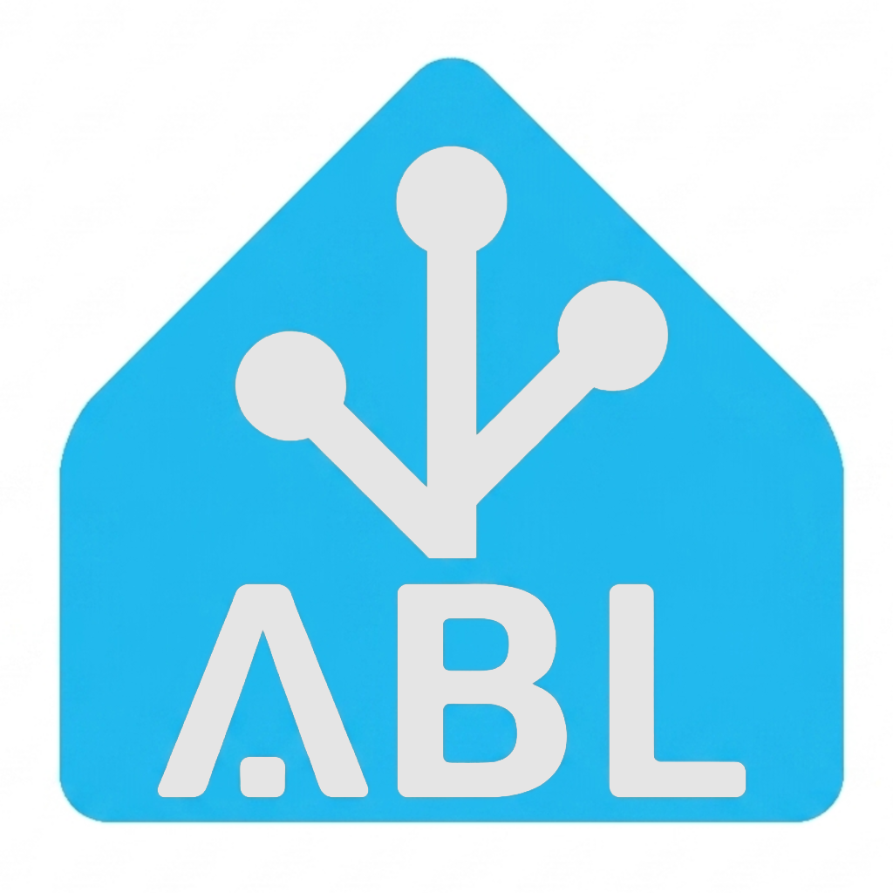
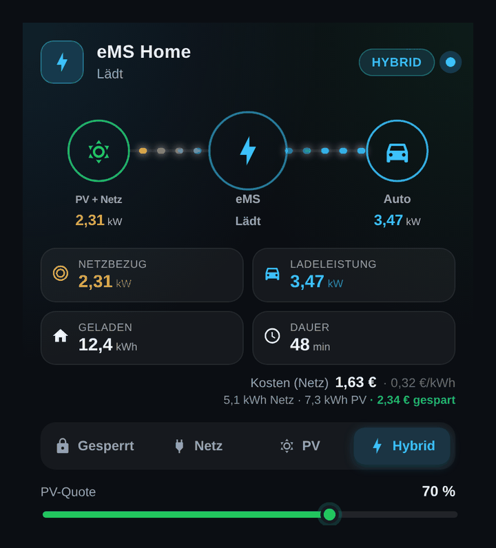
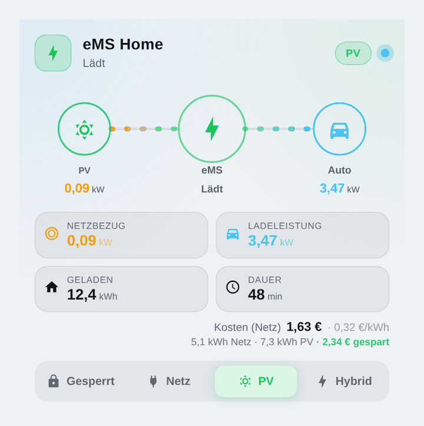
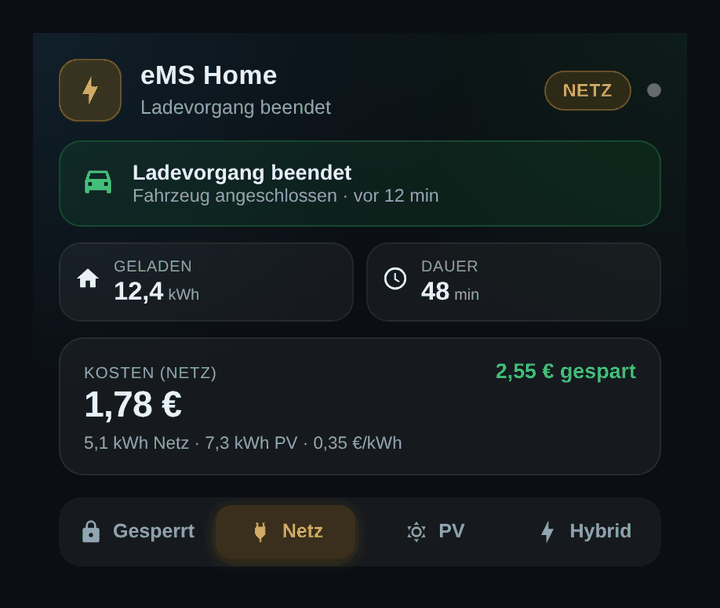
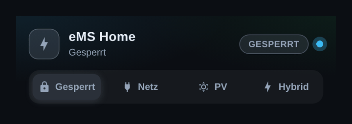
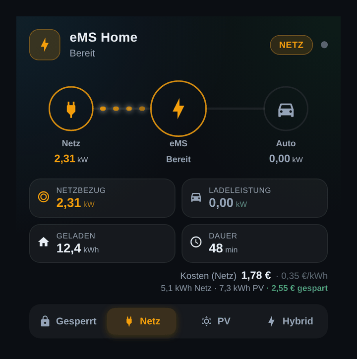

# ABL eMS Home for Home Assistant



[](https://hacs.xyz/)
[](https://github.com/TorbenStriegel/eMS-Home-HomeAssistant/releases)
[](LICENSE)
[![Add Integration][add-integration-badge]][add-integration]

Custom Home Assistant integration for the **ABL eMS Home** energy management system:
real-time smart meter data over WebSocket, EV charging monitoring and charge-mode
control for ABL eMH1 wallboxes — plus a bundled, animated Lovelace card.

## Features

- ⚡ **Live smart meter** – grid power (total + per phase), voltage, current, frequency, energy import/export, reactive power, power factor
- 🚗 **Wallbox live stream** – status, session duration, session energy, total energy, serial, hardware current limit, error code
- 🔌 **EV charging power** – total and per phase, plus a curtailment setpoint
- 🎛️ **Charge mode control** – Grid / PV / Hybrid / Lock as a select entity
- ☀️ **PV quota slider** – minimum PV surplus in 10 % steps (as in the original web UI), shown in hybrid mode where it applies
- 🖥️ **Device health** – CPU load/temperature, RAM and flash usage as diagnostic entities
- 🩺 **Self-diagnosing** – live-stream connectivity binary sensors, frame counters and a full diagnostics download
- 🎨 **Bundled card** – `custom:ems-home-card` with an animated energy flow (no manual resource setup)
- 🔄 **Self-healing** – WebSocket reconnect with backoff, keep-alive pings, handshake and read timeouts
- 🔐 **OAuth2** – automatic token management and renewal

## Installation via HACS (custom repository)

1. HACS → **Integrations** → ⋮ → **Custom repositories**
2. Repository: `https://github.com/TorbenStriegel/eMS-Home-HomeAssistant`, category **Integration**
3. Install **ABL eMS Home**, then **restart Home Assistant**

## Manual installation

Copy `custom_components/ems_home` into `config/custom_components/` and restart.

## Configuration

[![Add Integration][add-integration-badge]][add-integration] or **Settings → Devices & Services → Add Integration → ABL eMS Home**.

| Option | Description | Default |
|---|---|---|
| **Host** | IP address or hostname (e.g. `ems-home-12345678`) | – |
| **Password** | Password from the rating plate (user is always `admin`) | – |
| **Port** | HTTP port | `80` |
| **Poll interval** | Seconds between HTTP polls | `10` |
| **Request timeout** | Seconds per HTTP request | `10` |

Everything except the password can be changed later via **Configure**; the
password via the **re-authentication** flow (also triggered automatically when it
is rejected). The live streams can be disabled in the options for troubleshooting.

## The card

<p align="center">
  
  
</p>

<p align="center"><em>Charging in hybrid mode (dark) and in PV mode (light): the flow
shows where the energy comes from, the figures show what it is doing right now.</em></p>

The integration ships `custom:ems-home-card` and registers it automatically –
after installing or updating there is nothing to add to your dashboard resources.

- **The flow at a glance** – roof and grid on the left, wallbox in the middle, car on the right. The dots speed up with the power and reverse when you feed into the grid.
- **Live where it matters** – grid import refreshes every 5 s so the card stays calm, charging power is live.
- **Per cycle, not per day** – energy and duration belong to the current charging session and start over with the next one.
- **Control included** – Grid / PV / Hybrid / Lock plus the PV quota slider, which appears in hybrid mode where it applies.
- **Quiet when nothing happens** – locked and finished states show no animation and no meaningless zeros.

### The four states

<table>
  <tr>
    <td align="center" valign="top" width="33%">
      <br>
      <sub><b>Finished</b><br>The car is still plugged in but draws nothing: the
      animation gives way to the result – energy, duration, what the grid energy
      cost and what the roof saved.</sub>
    </td>
    <td align="center" valign="top" width="33%">
      <br>
      <sub><b>Locked</b><br>Nothing flows and nothing is worth showing, so only the
      header and the mode switch remain.</sub>
    </td>
    <td align="center" valign="top" width="33%">
      <br>
      <sub><b>Idle</b><br>The wallbox is ready and no car is connected – the flow
      still shows what the house is doing.</sub>
    </td>
  </tr>
</table>

### Configuration

```yaml
type: custom:ems-home-card
title: eMS Home
price: 0.32          # optional – grid tariff for the session cost
pv_price: 0.08       # optional – value of your own PV energy (default 0)
layout: full         # or "compact"
show_flows: true     # animated energy flow
show_controls: true  # mode buttons + PV quota slider
```

Entities are found through the entity registry, so nothing has to be configured –
even when the device has a name of its own (`sensor.controlroom_ems_home_ladeenergie`).
Override them only if you renamed an entity yourself:

```yaml
type: custom:ems-home-card
entities:
  grid_power: sensor.ems_home_grid_power
  ev_power: sensor.ems_home_ev_charging_power
  charge_mode: select.ems_home_charge_mode
  pv_quota: number.ems_home_min_pv_power_quota
  session_energy: sensor.ems_home_evse_session_energy
  pv_power: sensor.solar_roof_power        # optional, external PV sensor
```

### Cost per charge mode

The cost line prices **grid energy only**: during each cycle the integration
records how much of the charging power came from the meter and how much from the
roof (`5,1 kWh Netz · 7,3 kWh PV`). Set `pv_price` if you want to value your own
solar energy too – feed-in tariff or opportunity cost. Without it, PV energy
counts as free and the second figure is what the roof saved you:

| Charge mode | Cost of the cycle | Shown saving |
|---|---|---|
| **Grid** | full energy × `price` | – |
| **PV** | ≈ 0 (only surplus is used) | PV energy × `price` |
| **Hybrid** | grid share × `price` + PV share × `pv_price` | PV share × (`price` − `pv_price`) |
| **Lock** | – | – |

The split is measured, not assumed: while the car charges, whatever the meter
reports as import is attributed to the car first (capped at its own draw), the
rest counts as solar. It is an estimate – the house draws from the same meter –
and the session-energy sensor says so with `split_estimated: true`.

The card is fully theme-aware (light/dark), ships a GUI editor and needs no
external frontend dependency (no Mushroom, no card-mod).

> **`Custom element not found: ems-home-card`?** Home Assistant has not loaded the
> new code yet. Updating files is not enough – do a **full restart**
> (Settings → System → Restart), not just a reload of the integration. Afterwards
> the log contains `Registered eMS Home card at /ems_home_static/ems-home-card.js?v=…`.
> If it still fails, add that URL manually as a dashboard resource of type
> **module**; the integration also registers it automatically in storage mode.

## Entities

### Live streams (WebSocket, pushed by the device)

| Sensor | Unit |
|---|---|
| Grid power / L1–L3 | kW |
| Grid power export | kW |
| Grid apparent power | kVA |
| Grid voltage L1–L3 | V |
| Grid current L1–L3 | A |
| Grid frequency | Hz |
| Grid energy import / export | kWh |
| Grid reactive power / power factor | var / – |
| Wallbox status | – |
| Charging session duration | min |
| Charging session energy | kWh |
| Wallbox energy total | kWh |
| Wallbox maximum current / current limit | A |
| Wallbox serial number / error code | – |

### Polled (HTTP)

| Entity | Type |
|---|---|
| EV charging power / L1–L3 | sensor (kW) |
| Curtailment setpoint | sensor (kW) |
| EV charging state | sensor (idle / charging / locked) |
| Charge mode | select + sensor |
| Minimum PV power quota | number (0–100 %, slider, 10 % steps) |
| Minimum charging power quota | number (0–100 %, slider) |
| EV charging / EV plugged | binary_sensor |
| Overload protection | binary_sensor |
| Smart meter / wallbox live stream | binary_sensor (diagnostic) |
| Device status, CPU, RAM, flash | sensor (diagnostic) |

> Per-phase values and device health are **disabled by default** — enable them in
> the entity settings if you need them.

## Troubleshooting

| Symptom | Cause / fix |
|---|---|
| `unavailable` on grid sensors | The smart meter stream never delivered a frame. Check `binary_sensor.…smart_meter_live_stream`; if it is `off`, the device is not pushing (see below). |
| Everything `unavailable` | Host/port wrong or the device unreachable. Use **Configure** to change it — the connection is verified before saving. |
| `timeout` while polling | The eMS Home is a small embedded server. Raise **Request timeout** to 20 s and the poll interval to 30 s. |
| Password rejected | Use the **Re-authenticate** flow. |
| Values freeze | Check the `…live_stream` binary sensors and their `last_error` attribute. |

### Wallbox status values

| Value | Meaning |
|---|---|
| `available` | no vehicle connected |
| `occupied` / `preparing` | vehicle connected, not charging yet |
| `charging` | charging |
| `finishing` | session ending |
| `charging_paused` | session paused by the eMS Home's own regulation (PV/hybrid, missing surplus, grid limit) |
| `suspended_ev` / `suspended_evse` | suspended by the vehicle / by the wallbox |
| `faulted`, `unavailable`, `reserved` | see device display |
| `status_<n>` | a state the integration does not know yet – reported in the log once, please open an issue |

### Diagnostics

**Settings → Devices & Services → ABL eMS Home → Download diagnostics** returns the
decoded values *and* the stream statistics: frames received, bytes, undecodable
frames, reconnects, seconds since the last frame and the last error. Attach that
file to a bug report — it answers "is the socket open but silent?" immediately.

Unknown meter registers are not dropped: they are logged once
(`Unknown smart meter register 0x… (OBIS label)`) and reported under
`smart_meter_unknown_registers` in the diagnostics. That is how new firmware
registers get mapped.

### About the streams

Both streams authenticate with a first text frame (`Bearer <token>`) instead of
the usual header, and the device pushes sparsely — the wallbox only sends when
something changes. The client therefore:

* sends keep-alive pings and answers the device's pings (otherwise the socket is
  dropped after ~60 s),
* reassembles fragmented frames,
* never loses bytes that arrive together with the handshake response,
* gives up on a socket that stayed silent for 300 s and reconnects with backoff.

## Requirements

- ABL eMS Home on the local network (firmware as of 2024+)
- Home Assistant **2024.11** or newer
- The password from the rating plate

## Development

```bash
pip install -r requirements_test.txt
python -m pytest tests -q          # protocol + WebSocket tests, no HA needed
python tests/mock_device.py        # mock eMS Home for local end-to-end runs
```

### Probing a real device

`tools/probe_device.py` uses the integration's own WebSocket client and decoder,
so its output is exactly what Home Assistant sees. Run it on any machine that can
reach the device (e.g. the Home Assistant host):

```bash
python tools/probe_device.py --host 192.168.178.86 --password '***' --json report.json
```

It prints the HTTP endpoints, the connection state of both streams, the first raw
frames and the decoded values – the fastest way to tell whether a stream is
"connected but silent", whether frames fail to decode, or which meter registers
are unknown.

The tests cover protobuf decoding, scaling, unknown registers, fragmented frames,
ping/pong handling, reconnects and the handshake.

## License

MIT — see [LICENSE](LICENSE).

## Credits

Based on reverse engineering of the ABL eMS Home local API. Not affiliated with or
endorsed by ABL.

[add-integration]: https://my.home-assistant.io/redirect/config_flow_start?domain=ems_home
[add-integration-badge]: https://my.home-assistant.io/badges/config_flow_start.svg
